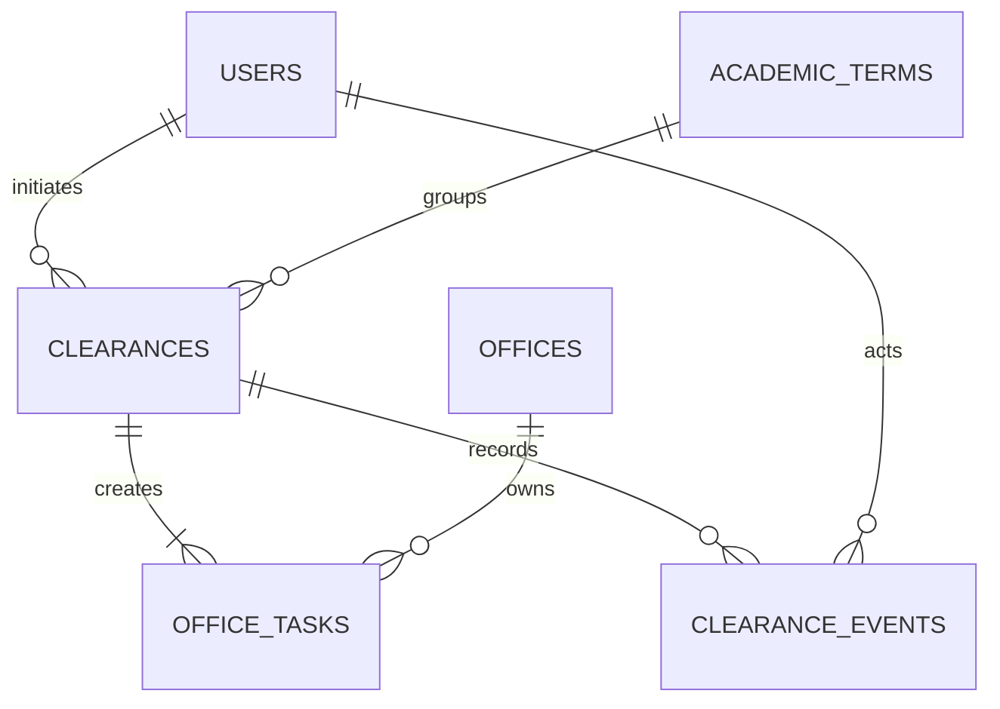

# Clearance Data Model and Access Control

## Checkpoint 2 boundary

This checkpoint implements only authenticated clearance initiation. It prepares the records needed by later office review and automation without implementing those later actions early.

## Role boundary

| Role | Implemented permission | Server-side control |
| --- | --- | --- |
| Student | Initiate one clearance for one active term | Sanctum authentication plus `role:student` middleware |
| Clearing-office personnel | No initiation permission | Request is rejected with `403 ROLE_FORBIDDEN` |
| Authorized administrator | No initiation permission | Request is rejected with `403 ROLE_FORBIDDEN` |

The API never accepts a role, student identifier, or office assignment from the Flutter request. It derives identity and role from the authenticated Laravel user.

## SQL-backed records

- `offices` stores the controlled clearing-office list and active ordering.
- `academic_terms` stores controlled terms; only active terms can be selected.
- `users.role` defines the bounded role, while `users.office_id` restricts future office personnel to one office.
- `clearances` has unique student-term and student-idempotency-hash guards.
- `office_tasks` has one unique clearance-office pair, preventing duplicate office work.
- `clearance_events` records the initiating actor, event type, correlation identifier, controlled metadata, and timestamp.

## Transaction and recovery behavior

The initiation service validates the active term and office configuration before opening a database transaction. Inside the transaction it locks the student-term lookup, creates the clearance, creates one task per active office, and writes one event. Any exception rolls back the whole unit, so validation, authorization, duplicates, and unavailable configuration cannot leave partial tasks.

## Fictional seed data

The seeder creates Registrar, Library, Accounting, and Student Affairs offices; one active academic term; and one fictional account for each role. It generates a random non-recoverable development password at seed time and does not commit a usable token or password.
