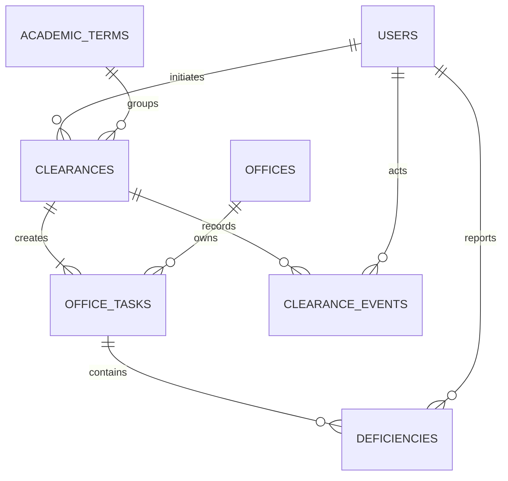

# Clearance Data Model and Access Control

## Checkpoint 3 boundary

This checkpoint implements authenticated clearance initiation, assigned-office review, deficiency resolution by the owning student, task approval, and overall completion. Reminder, escalation, retry, recovery, notification, and Flutter integration remain later Week 13 checkpoints.

## Role boundary

| Role | Implemented permission | Server-side control |
| --- | --- | --- |
| Student | Initiate own clearance and resolve deficiencies belonging to it | Sanctum, `role:student`, and server-side clearance ownership check |
| Clearing-office personnel | Report deficiencies and approve tasks assigned to their office | Sanctum, `role:office`, and server-side `office_id` match |
| Authorized administrator | No review mutation at this checkpoint; later human-action oversight only | Review routes reject the role with `403 ROLE_FORBIDDEN` |

The API never accepts a role, student identifier, or office assignment from the Flutter request. It derives identity and role from the authenticated Laravel user.

## SQL-backed records

- `offices` stores the controlled clearing-office list and active ordering.
- `academic_terms` stores controlled terms; only active terms can be selected.
- `users.role` defines the bounded role, while `users.office_id` restricts future office personnel to one office.
- `clearances` has unique student-term and student-idempotency-hash guards.
- `office_tasks` has one unique clearance-office pair, preventing duplicate office work.
- `deficiencies` preserves the office description, status, student resolution note, reporter, and resolution time. Only one open deficiency is allowed by the workflow service for a task.
- `clearance_events` records the initiating actor, event type, correlation identifier, controlled metadata, and timestamp.

## Review transaction behavior

The workflow service locks the affected task or deficiency before checking its current state. Accepted changes update the task and deficiency and append a correlated event in one transaction. Approval is allowed only from `pending` or `awaiting_re_review`. After each approval, the service locks the parent clearance and marks it completed only when no unapproved tasks remain. A `clearance_completed` event is therefore created once at the final approval boundary.

## Transaction and recovery behavior

The initiation service validates the active term and office configuration before opening a database transaction. Inside the transaction it locks the student-term lookup, creates the clearance, creates one task per active office, and writes one event. Any exception rolls back the whole unit, so validation, authorization, duplicates, and unavailable configuration cannot leave partial tasks.

## Fictional seed data

The seeder creates Registrar, Library, Accounting, and Student Affairs offices; one active academic term; and one fictional account for each role. It generates a random non-recoverable development password at seed time and does not commit a usable token or password.
