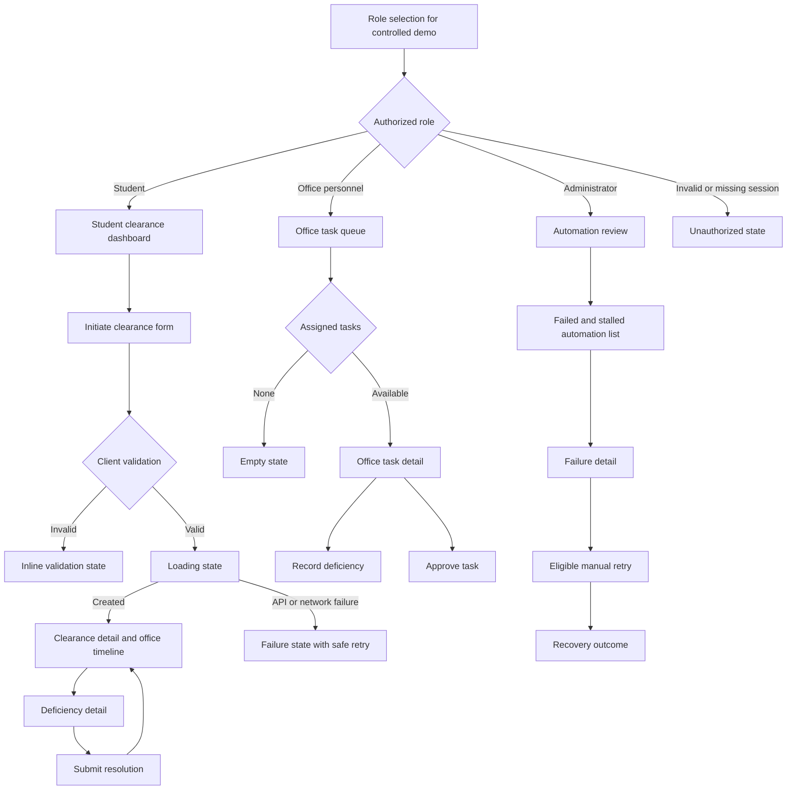

# Flutter Web Screen Flow

Every data surface must include loading, success, empty, validation, unauthorized or forbidden, network or server failure, and recovery feedback. Wide layouts may use navigation rail plus content; narrow layouts collapse to a top app bar and one-column content without removing actions.
