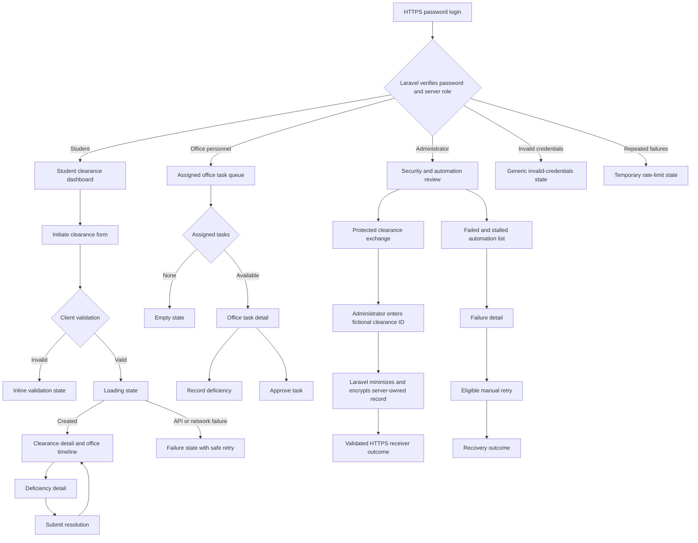

# Flutter Web Screen Flow

The browser never selects a trusted role. It submits credentials over the controlled HTTPS endpoint and renders the dashboard identified by Laravel. Tokens remain in memory and are revoked on logout. Every data surface must include loading, success, empty, validation, unauthorized or forbidden, network or server failure, and recovery feedback. Wide layouts use a two-column login composition; narrow layouts collapse to one scrollable column without removing fields or actions.
