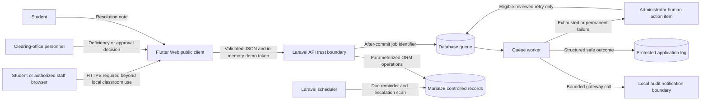

# System Data Flow and Trust Boundaries

## Purpose

This diagram records the Week 13 data flow, trust boundaries, protected configuration, logs, failure paths, and human approval points for Project 8.

## Trust boundaries and protected information

| Boundary | Trusted information | Untrusted or minimized information | Control |
| --- | --- | --- | --- |
| Browser to Laravel API | Server-authenticated user, role, office and ownership | Client role, owner, status, retry count and timestamps | Sanctum token, server authorization, request validation and safe errors |
| Laravel to MariaDB | Validated state transition and server-generated identifiers | Direct client database values | ORM queries, transactions, row locks and unique constraints |
| Queue worker to gateway | Delivery ID, automation type, idempotency key and correlation ID | Secrets and unnecessary personal message content | Gateway interface, bounded attempts and sanitized logging |
| Failure to human action | Safe error code, owner role and next step | Token, password, exception trace and sensitive record content | Administrator-only inspection and eligible retry |

## Human approval points

- Clearing-office personnel decide whether to report a deficiency or approve an eligible assigned task.
- The owning student decides whether and how to submit a deficiency-resolution note.
- The same office re-reviews the resolved deficiency.
- An authorized administrator reviews stalled automation and permanent failure before any eligible retry.
- Automation never changes an office decision or silently discards a permanent failure.

## Explicit limitation

The local classroom demonstration uses HTTP on loopback and a local audit gateway. It does not claim production transport security, provider authentication, real notification delivery, institutional identity integration, or production monitoring.
