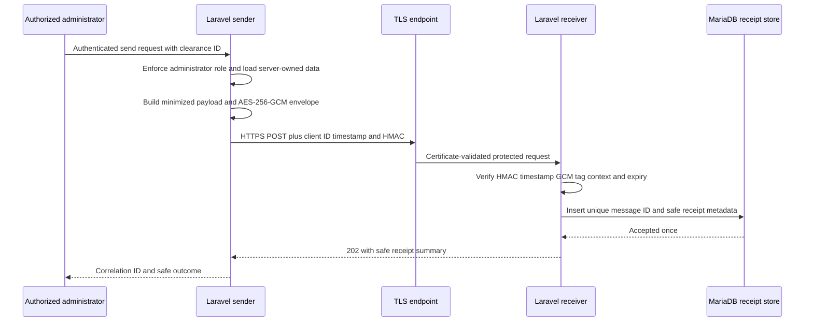

# Week 14 Secure Exchange Design

## Decision question

How can the Student Clearance Workflow exchange the minimum required clearance status with a controlled receiver while preventing unauthorized disclosure, undetected alteration, expired-message acceptance, replay, and secret leakage?

## Bounded scope

The Week 14 sender is an administrator-only Laravel API action. It reads an existing clearance, derives a minimized service payload, encrypts it, authenticates the service request, and sends it to a controlled HTTPS receiver. The receiver verifies transport trust, the HMAC service identity, the authenticated-encryption tag, the message context, the time window, and the unique message identifier before recording a safe receipt.

The exchange includes the clearance reference, academic term code, overall status, office code and decision status, approval time, and deficiency status, description, resolution note, and resolution time. It excludes the student's name, email, password, access token, internal database user identifier, reviewer identity, automation history, and unrelated profile data.

## Trust boundaries and data flow

## Protection objectives and controls

| Objective | Selected control | Reason | Limitation |
| --- | --- | --- | --- |
| Transport confidentiality and server authentication | TLS 1.2 or 1.3 with hostname and CA validation | Protects the full HTTP exchange and detects an untrusted endpoint | The local certificate proves only the controlled localhost arrangement |
| Sensitive payload confidentiality and integrity | AES-256-GCM with a random 96-bit nonce and 128-bit tag | Established authenticated encryption detects ciphertext or authenticated-metadata changes | Both services currently share one symmetric key |
| Calling-service authentication | HMAC-SHA-256 over timestamp and exact JSON body | Authenticates the configured sender before decryption | Shared-secret compromise affects both sender and receiver |
| Freshness | Signed request timestamp and five-minute encrypted-message expiry | Rejects stale service calls and expired envelopes | Clock synchronization remains an operational dependency |
| Replay prevention | Unique UUID message ID stored in MariaDB | A valid envelope can be processed only once | Receipt retention must exceed the replay-risk period |
| Human-user authorization | Sanctum plus administrator role middleware | Only an authenticated administrator can ask the sender to exchange a clearance | The controlled Week 13 demo-session route is disabled by default in Week 14 |
| Password protection | Laravel's hashed password cast and framework hashing | Passwords require slow one-way hashing, not reversible encryption | Full user-facing password login is a later Week 14 checkpoint |
| Safe diagnostics | Correlation ID, message ID, safe status, and counts only | Supports investigation without logging keys, tokens, plaintext, or ciphertext | Operational log access controls are not demonstrated on localhost |

## Cryptographic selection record

### Selected design

The implementation uses PHP OpenSSL AES-256-GCM for the protected payload. The 32-byte key comes from the ignored local environment file, every message receives a new random 12-byte nonce, and the GCM tag authenticates both the ciphertext and the envelope metadata. HMAC-SHA-256 serves a different objective: it authenticates the configured calling service before the receiver attempts decryption. HTTPS remains mandatory because payload encryption does not protect HTTP headers, endpoint identity, traffic metadata, or error responses.

### Alternatives considered

Laravel `Crypt` was feasible and also provides authenticated encryption, but its framework envelope hides nonce and message metadata that the laboratory needs to examine and test directly. AES-CBC without a separate MAC was rejected because encryption alone would not reliably detect modification. A digital signature was not added because this bounded localhost integration has one mutually controlled sender and receiver and no requirement for third-party verification or non-repudiation. If services later have different owners or recipients must verify messages without sharing a secret, an approved asymmetric signature design should be reviewed.

## Key lifecycle

The setup tool generates the AES key and HMAC secret with the operating system random source and writes them only to ignored `backend/.env`. The local TLS tool generates a localhost certificate and private key under ignored `backend/storage/https`. The repository contains placeholders and reproducible scripts, not usable secrets. Suspected compromise requires rotating the affected value, restarting the services, rejecting old messages, and recording the incident without copying the secret into logs or evidence.

## Acceptance criteria

1. A correctly signed, unexpired, unmodified envelope is accepted once and creates one safe receipt.
2. Altered ciphertext, a wrong encryption key, an invalid HMAC, an expired signed request, an expired encrypted message, and a replay are rejected without a receipt or workflow change.
3. An unauthenticated user and a non-administrator cannot invoke the sender.
4. The configured receiver URL must use HTTPS and the sender must validate the configured CA certificate.
5. Logs and responses exclude passwords, access tokens, encryption keys, HMAC secrets, plaintext deficiency details, and ciphertext.

## Controlled local setup

1. Copy `backend/.env.example` to the ignored `backend/.env`, generate `APP_KEY`, and run `tools/configure-local-secrets.php` to create fresh AES and HMAC values.
2. Run `tools/generate-local-https.ps1` to create a localhost certificate and private key under ignored `backend/storage/https`.
3. Create the fictional-data database `student_clearance_workflow`, then run `php artisan migrate:fresh --seed`.
4. Start the controlled HTTPS endpoint with `tools/start-local-https.ps1` and verify `https://localhost:8443/up` using the configured CA certificate.
5. Run `php tools/run-secure-exchange-demo.php` and the secure-exchange test suite. Never copy `.env`, private keys, live secrets, or plaintext deficiency details into evidence.

## Checkpoint 1 verification record

- The localhost endpoint negotiated TLS 1.3 with `TLS_AES_256_GCM_SHA384`; OpenSSL reported hostname/certificate verification OK.
- A request using the configured CA returned HTTP 200. A request without that trust configuration failed with curl exit 60 and an untrusted-root result.
- The controlled sender/receiver demonstration accepted message `b8f1fc17-fb55-43dd-9dcb-91836bb3f173` for fictional clearance `CLR-000001`, recording one receipt with a 64-character SHA-256 payload hash.
- The focused secure-exchange suite passed 12 tests and 44 assertions. The full backend suite passed 44 tests and 178 assertions, and Laravel Pint passed.
- Composer first reported seven advisories affecting Symfony 7.4.22 packages. The four affected packages were updated to 7.4.23; the final audit reported no known advisories and the regression suite still passed.
- Database setup and detached HTTPS startup each failed safely on the first attempt. MariaDB was started before rerunning migration/seed, and the HTTPS endpoint was verified using the foreground managed process. These are recorded as setup/recovery evidence rather than hidden.

## Current limitations

- The receiver is a controlled local endpoint, not a separately owned university system.
- The local certificate is validated by the controlled command-line sender through an explicit CA file, but it has not been added to the browser trust store; Flutter HTTPS browser evidence remains pending.
- The administrator Flutter screen has not yet been extended with the secure-exchange action.
- Password login, Activity 1, Activity 2, SA8, IA5, the complete report, and final screenshot evidence remain later Week 14 milestones.
- Key rotation, revocation, backup protection, centralized secret management, and production certificate operations are documented risks, not demonstrated production capabilities.
