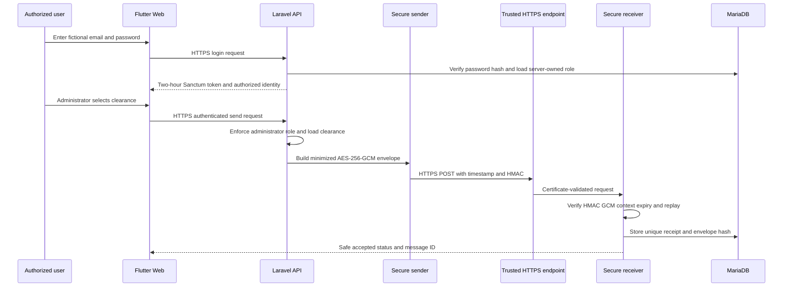

# Week 14 Secure Data Exchange and Encryption Report

**Project:** Project 8 Student Clearance Workflow

**Student:** Malapote, Xhyrone Wayne N.

**Course and section:** BSIT 3-A

**Assessments:** SA8 Secure Integration Architecture Case and IA5 Secure Data Exchange Build

**Repository:** `IPT_Weeks-13-18_Student-Clearance-Workflow`

**Branch:** `week14-secure-integration`

## Report purpose and conclusion

Week 14 extends the approved Week 13 Student Clearance Workflow with password authentication, server-enforced role and ownership rules, protected configuration, a minimized sender-and-receiver exchange, authenticated encryption, calling-service authentication, replay protection, and verified local HTTPS. The implementation passed 47 backend tests with 201 assertions and six Flutter widget tests. A real browser journey verified generic invalid credentials, student and Library-office role boundaries, an administrator-only secure exchange, and responsive desktop and narrow layouts.

The build meets the bounded module laboratory and Project 8 security requirements in a controlled local environment. It is not a production university deployment. The receiver is locally controlled, the Flutter development page is served over local HTTP while its API requests use trusted HTTPS, and production certificate operations, centralized key management, log access control, backup protection, and independent receiver ownership remain outside the verified scope.

## Requirement sources and approved scope

The main Week 14 module requires a small sender-and-receiver integration that sends a minimized record over HTTPS, protects the sensitive payload with established authenticated encryption, keeps keys outside source code, rejects alteration and replay, and preserves evidence without exposing secrets. Project 8 requires authentication, role-based authorization, HTTPS, protected configuration, input validation, safe logging, data minimization, adverse behavior, and residual-risk documentation.

There is no conflict between these requirements. The guide requires each cryptographic control to have a protection objective; the laboratory requires authenticated encryption. The implementation therefore uses authenticated encryption only for the minimized inter-service payload and uses different controls for passwords, calling-service identity, transport, authorization, and replay.

The Week 14 scope protects clearance requests, office decisions, deficiency details and resolution notes, approval states, and completion status. It does not connect to a production university system, use real student records, implement public deployment, or add optional future-week features.

## Inherited Week 13 baseline

Week 14 began from the immutable Week 13 tag `v13.0.0-week13-automation` at commit `6a73790b433ec65d34189aa3e3d7add80280b761`. The inherited Laravel and Flutter project already supported clearance initiation, office task creation, office review, deficiency resolution, approvals, completion, reminders, stalled-step escalation, bounded retry, permanent-failure review, structured audit events, and fictional seeded data.

Week 14 preserved that history and continued in the same repository. Checkpoint 1 added the secure exchange and was pushed as `7cf96482235715d81f6b99dea45d21b44cf6fe98`. Checkpoint 2 added password authentication, Flutter role-bound navigation, the administrator secure-send action, and the real browser journey and was pushed as `5f7bbc030578bd557b94ee342bd65f7a23be54eb`.

## Bounded workflow and security actors

The student signs in and may view or act on only the clearance owned by that authenticated student. A clearing-office user signs in and may review only tasks assigned to that user's server-owned office. An administrator may inspect automation failures and initiate the secure clearance-status exchange. The receiver accepts a protected message only when the calling service, message integrity, message context, time window, and message identifier are valid.

The user does not choose a role in Flutter. Laravel returns the role and office assignment from the stored user record after verifying the password. Authorization middleware and service-level ownership checks remain authoritative even if a client sends modified fields or calls an endpoint directly.

## Data flow and trust boundaries



Trust boundaries exist between the browser and Laravel API, the authenticated user and protected endpoints, the sender and receiver, configuration and source control, and the receiver and receipt database. The browser is a public client and holds no encryption key, service HMAC secret, TLS private key, or database credential.

## Data classification and minimization

| Data group | Classification | Required protections | Exchange decision |
| --- | --- | --- | --- |
| Password | Secret credential | Slow one-way hashing, rate limiting, safe errors | Never exchanged or logged |
| Access token | Secret bearer credential | Short lifetime, HTTPS, revocation, no logging | Never placed in protected payload |
| Deficiency description and resolution note | Sensitive workflow data | Least privilege, HTTPS, authenticated encryption in service exchange | Included only because the receiver needs clearance status detail |
| Office decision and approval time | Sensitive workflow state | Authorization, integrity, replay protection, auditability | Included in minimized exchange |
| Student name and email | Personal identity data | Authorization and minimization | Excluded from service exchange |
| Clearance reference, term, overall status | Controlled workflow data | Integrity, authenticity, confidentiality in exchange | Included |
| Keys and private certificates | Secret configuration | Ignored storage, restricted access, rotation | Never committed, logged, or captured |
| Correlation ID and message ID | Audit metadata | Integrity and retention | Logged without secrets |

The exchange excludes student name, email, password, access token, internal user identifier, reviewer identity, automation history, and unrelated profile fields. The receiver stores message metadata and a SHA-256 envelope hash, not the plaintext or ciphertext.

## Threat summary

| Threat | Likely effect | Implemented control | Verification | Residual risk |
| --- | --- | --- | --- | --- |
| Password guessing and account discovery | Unauthorized login or user enumeration | Laravel password hashing, dummy-hash check, generic error, five attempts per minute | Authentication tests and invalid-credential browser capture | No multifactor authentication or distributed rate limiter |
| Client-supplied role escalation | Unauthorized administrative or office access | Server-owned role and office, Sanctum, role middleware | Authentication and authorization tests | Compromised administrator account retains its legitimate authority |
| Student or office cross-record access | Disclosure or unauthorized workflow changes | Ownership and assigned-office checks | Clearance and office workflow regression tests | Future endpoints must repeat the same server-side rules |
| Network interception | Password, token, or workflow disclosure | HTTPS with hostname and CA validation | TLS 1.3 health check and failed untrusted-root request | Local development certificate is not a public production certificate |
| Ciphertext or metadata alteration | Undetected data modification | AES-256-GCM with metadata as additional authenticated data | Altered-ciphertext and wrong-key tests | Shared-key compromise defeats confidentiality and integrity |
| Unauthorized service call | Fake receiver request | HMAC-SHA-256 over timestamp and exact body | Invalid-HMAC and expired-request tests | Sender and receiver share one service secret |
| Replay | Duplicate processing | Five-minute validity window and unique message ID receipt | Replay test returns 409 and stores one receipt | Receipt retention must exceed the replay-risk period |
| Secret leakage | Complete loss of protected exchange | Ignored `.env` and TLS directory, example placeholders, secret scanning | Repository scan and configuration inspection | Local endpoint access controls were not evaluated as production controls |
| Dependency vulnerability | Known exploitable framework component | Composer audit and package remediation | Seven findings remediated; final audit clean on 2026-11-07 | New advisories may appear after the recorded date |
| Dependency or key unavailability | Failed exchange | Safe 503 errors and no receipt | Missing CA and unavailable-key tests | No production high-availability key service was tested |

## Security architecture and selected controls

### Authentication and session handling

Laravel validates the email and password, normalizes the email, and verifies the password with the framework `Hash` facility. Unknown accounts run the same dummy hash check as known accounts to reduce timing and enumeration differences. Wrong-password and unknown-email attempts receive the same `INVALID_CREDENTIALS` response. Login is limited to five attempts per minute. A successful login revokes the account's previous Flutter token and issues one Sanctum token with the `workflow` ability and a two-hour expiry. Logout deletes the current token.

Passwords are hashed, not encrypted. Hashing is one-way and is appropriate because the application needs to verify a password rather than recover it. General-purpose SHA-256 is not used for passwords because it is intentionally fast and lacks a password-specific work factor.

### Authorization and least privilege

The authenticated route group requires Sanctum. Student endpoints require the `student` role; office review endpoints require the `office` role; automation failure and secure-send endpoints require the `admin` role. Domain services additionally enforce student ownership and office assignment. Flutter receives the server-owned role after login and displays only the corresponding dashboard, but the server remains authoritative.

An unauthenticated request receives 401. An authenticated user with the wrong role receives 403 with the safe `ROLE_FORBIDDEN` code. These results distinguish missing identity from a forbidden action without granting the client authority to select a role.

### Authenticated encryption

The sender uses PHP OpenSSL AES-256-GCM with a fresh 12-byte random nonce and a 16-byte tag. The 32-byte key comes from ignored environment configuration. Metadata containing the message ID, issue and expiry times, sender, recipient, version, and purpose is supplied as additional authenticated data. A change to the ciphertext or metadata causes decryption to fail with the safe `ALTERED_OR_WRONG_KEY` result.

AES-GCM was selected because the laboratory requires visible authenticated-encryption behavior, nonce handling, metadata authentication, and tamper testing. AES-CBC without a MAC was rejected because encryption alone would not reliably detect modification. Laravel `Crypt` was feasible but its framework envelope would hide laboratory details that the student must inspect and explain.

### Calling-service authentication

HMAC-SHA-256 covers the request timestamp, a newline, and the exact JSON body. This is message authentication: the receiver can verify both possession of the shared service secret and the integrity of the signed request. The receiver checks the configured client identifier, timestamp skew, and HMAC before decryption. HMAC is not used as password hashing or as a replacement for TLS.

A digital signature was not added because the bounded sender and receiver are under one controlled local owner and have no third-party verification or non-repudiation requirement. If the services later have independent owners, an approved asymmetric signing design should be reviewed so the receiver can verify with a public key without holding the sender's private key.

### Transport security

The sender requires an `https://` receiver URL and verifies the configured CA certificate. The controlled endpoint negotiated TLS 1.3 with `TLS_AES_256_GCM_SHA384`, returned HTTP 200 with the configured CA, and failed with curl exit 60 when that trust was omitted. HTTPS remains required even though the sensitive payload is encrypted because TLS protects credentials, tokens, HTTP headers, endpoint identity, error responses, and traffic in transit.

The Flutter page itself used local HTTP for development, but every credential-bearing browser API request went to the trusted local HTTPS API. This is explicitly a controlled test arrangement and does not claim an all-HTTPS production deployment.

### Keys and protected configuration

The setup utility generates AES and HMAC secrets with the operating-system random source and writes them only to ignored `backend/.env`. The certificate and private key remain under ignored `backend/storage/https`. Tracked configuration contains placeholders and reproducible scripts. The Flutter source contains no service key or database secret.

A suspected compromise requires replacing the affected secret, restarting the sender and receiver, invalidating old tokens or messages as applicable, and recording the incident without copying the secret into logs or evidence. Production rotation, revocation, backup protection, centralized secret storage, and certificate renewal remain documented responsibilities rather than demonstrated capabilities.

### Safe errors logs and receipts

API errors use consistent codes, safe messages, field errors, and correlation identifiers. Logs record event name, message ID, clearance reference, status, counts, and correlation ID. They exclude passwords, tokens, keys, plaintext protected payloads, ciphertext, and unnecessary identity data. The receiver stores a unique message ID and SHA-256 envelope hash so it can investigate and reject a duplicate without retaining the sensitive exchange content.

## Activity 1 Review of Five Cryptographic Uses

### Decision question

Which cryptographic control correctly meets each protection objective in the Student Clearance Workflow without placing secrets in the Flutter client or adding an unjustified mechanism?

### Assumptions constraints and authority

The build uses fictional data, one Laravel backend, one controlled receiver, and a trusted localhost HTTPS arrangement. The authorized administrator may initiate the exchange. The application maintainer owns local secret rotation and certificate setup. The instructor accepts the assessment result; no production office approval or university deployment authorization is claimed.

### Five proposed uses and corrected designs

| Proposed use | Objective | Problem | Corrected design | Operational assumptions and risk |
| --- | --- | --- | --- | --- |
| Encrypt user passwords with AES so they can be recovered | Verify user identity | Reversible storage exposes every password if the key is compromised | Use Laravel password hashing with a password-specific work factor; compare through `Hash::check` | Hash parameters and framework versions need maintenance; password reuse and phishing remain possible |
| Send an SHA-256 hash beside plaintext to detect modification | Message integrity and caller authenticity | An attacker can alter both plaintext and an unkeyed hash | Use HMAC-SHA-256 for service authentication and AES-GCM for protected-payload integrity | The HMAC secret must remain server-side and clocks must stay within the accepted skew |
| Encrypt the clearance record with AES-CBC and no MAC | Confidentiality and integrity | CBC encryption alone does not authenticate ciphertext or metadata | Use AES-256-GCM with a fresh random nonce, 128-bit tag, and authenticated context | Nonces must not repeat under one key; shared-key compromise affects both services |
| Place the AES and HMAC keys in Flutter so the browser can encrypt requests | Client-to-service confidentiality | Browser code and compiled assets cannot keep a shared secret confidential | Keep service keys in ignored server configuration and use HTTPS plus user tokens from Flutter | The backend becomes responsible for protected configuration and key rotation |
| Add a digital signature to every localhost message | Non-repudiation and independent verification | No independent verifier or separate owner exists in the bounded build, so key-pair operations add cost without a requirement | Use HMAC for the mutually controlled service call; review asymmetric signatures if ownership separates | HMAC does not provide public verification or non-repudiation |

### Alternatives and decision

The first feasible approach was TLS plus Laravel `Crypt` and framework authentication. It would be simpler but would make the required nonce, authenticated metadata, and tamper exercise less explicit. The selected approach uses TLS, explicit AES-256-GCM, HMAC, Sanctum, framework password hashing, and database replay receipts. It costs more code and key-management responsibility but directly supports the laboratory's adverse tests and defense questions. A public-key signature and hybrid encryption design was also feasible, but it was rejected because the bounded services share one controlled owner and no independent verifier exists.

### Adverse case

The altered-ciphertext test flips one ciphertext bit, recomputes the valid service HMAC, and submits the message. The receiver returns 422 `ALTERED_OR_WRONG_KEY` and stores no receipt. This isolates authenticated-encryption integrity from service authentication: a valid caller still cannot submit modified protected content.

### Activity 1 One Page Interpretation

**Observed facts.** The application accepted one correctly signed, unexpired AES-256-GCM envelope and rejected alteration, a wrong encryption key, an invalid service HMAC, an expired request, an expired encrypted message, and replay. Laravel stored password hashes rather than plaintext passwords. The browser received its role from the authenticated server response. The repository scan found no live key, private certificate, token, or plaintext browser password in the tracked candidates.

**Reasoned conclusions.** Cryptographic mechanisms are not interchangeable. Password hashing is appropriate when the original password must never be recovered. AES-GCM protects the confidentiality and integrity of a specific service payload. HMAC authenticates the calling service, while TLS authenticates the endpoint and protects the entire HTTP conversation. A signature is useful when independent verification or non-repudiation is required, but those objectives are absent from this controlled same-owner exchange. The strongest design is therefore the one that maps each mechanism to a stated objective and preserves the operational assumptions required to keep it valid.

**Recommendations.** Keep all service secrets out of Flutter and source control. Retain the selected AES-GCM, HMAC, HTTPS, Laravel hashing, and server authorization controls for this bounded build. Before broader use, replace local secrets with an approved managed store, define rotation and certificate renewal procedures, consider asymmetric signing if receiver ownership separates, and add production monitoring and access control for security logs.

## Activity 2 Secure Exchange Review

### Decision question

Does the implemented secure exchange provide reproducible evidence for source correctness, protected configuration, trusted transport, tamper rejection, secret hygiene, and stated residual risk?

### Review method and results

| Review area | Method | Observed result | Evidence |
| --- | --- | --- | --- |
| Source inspection | Reviewed envelope creation, decryption, metadata validation, receipt insertion, sender HTTPS configuration, authentication controller, routes, and tests | Required controls are explicit and separated by purpose | `SecureClearanceExchange.php`, `SecureExchangeSender.php`, `AuthenticationController.php`, `routes/api.php` |
| Configuration review | Inspected `.env.example`, ignored secret paths, and setup tools | Tracked files contain placeholders and scripts; live values remain ignored | design record and repository scan |
| HTTPS verification | Tested configured CA, hostname, TLS negotiation, and omitted-trust control | TLS 1.3 succeeded with validation; omitted CA failed with exit 60 | `EVID-W14-HTTPS-001` |
| Tamper and adverse tests | Ran focused secure-exchange and authentication suites | 12 secure-exchange tests and five authentication tests passed | `EVID-W14-SEC-001` and `EVID-W14-AUTH-001` |
| Full regression | Ran all Laravel tests and Flutter checks | 47 backend tests with 201 assertions, no Flutter analysis issue, six widget tests | authentication test record |
| Secret scanning | Searched tracked candidates and reviewed captures | No live secret or temporary plaintext credential remained | evidence index and cleanup record |
| Dependency review | Ran Composer audit, updated affected Symfony packages, reran regression | Seven initial advisories were remediated; final audit was clean on the execution date | `EVID-W14-AUDIT-001` |
| Browser review | Executed desktop/narrow login and all three roles | Six real states passed and were visually inspected | `EVID-W14-BROWSER-001` and application screenshots |

### Alternatives and improvement decision

One review approach would accept only a successful browser demonstration. That approach is quick but cannot prove tamper, replay, wrong-key, missing-CA, or unavailable-key behavior. The selected approach combines source inspection, configuration review, command-line transport verification, automated adverse tests, dependency audit, secret scan, and real browser states. It takes longer but produces traceable evidence for both normal and failure behavior.

The improvement applied after review was not limited to documentation. The initial dependency audit found seven advisories in Symfony 7.4.22 components. The affected packages were updated to 7.4.23 and the complete regression suite passed afterward. Authentication verification also preserved and corrected three genuine test findings: cached guard state, off-screen widget interaction, and a missing test import.

### Controlled failure and safe behavior

The first database setup failed because MariaDB was stopped. The first detached HTTPS start did not leave a verified listener. Neither attempt was recorded as success. Recovery required confirming database reachability, running migrations and seeders, starting HTTPS in a managed foreground process, and verifying both TLS and an application-level exchange. These findings support the conclusion that process-start output alone is not readiness evidence.

### Residual risk register

| Risk | Current status | Consequence | Next authorized improvement |
| --- | --- | --- | --- |
| Local same-owner receiver | Accepted for laboratory only | Does not prove interoperability or governance across independent offices | Test with a separately owned nonproduction receiver |
| Shared AES and HMAC secrets | Controlled local environment | One compromise affects both endpoints | Move to managed secrets and consider per-service keys or signatures |
| Local certificate trust | Current-user development trust | Does not prove public certificate issuance or renewal | Deploy to an approved nonproduction HTTPS host in Week 16 |
| Flutter page on local HTTP | Development limitation | Page assets are not protected by TLS even though API credentials are | Serve the entire web application through trusted HTTPS before broader use |
| No multifactor authentication | Outside Week 14 scope | Stolen password may allow access until detection or token expiry | Evaluate approved MFA and recovery policy |
| Local logs | Safe fields demonstrated | Production retention and access control remain unverified | Define centralized access, retention, alerting, and review ownership |
| Receipt retention not automated | Documented dependency | A deleted receipt may weaken long-term replay detection | Set retention longer than the accepted replay-risk period |
| Audit validity changes over time | Clean only on 2026-11-07 | New advisories may affect the locked graph | Repeat audit at each checkpoint and before release |

### Activity 2 One Page Interpretation

**Observed facts.** Source inspection showed AES-256-GCM with a fresh nonce, authenticated metadata, HMAC over the timestamp and exact body, HTTPS CA verification, unique receipt insertion, safe logs, Laravel password hashing, short-lived tokens, and role middleware. The controlled transport check negotiated TLS 1.3 and rejected an untrusted root. Automated tests covered success and more than four adverse paths. The full backend and Flutter regression passed. Real browser captures showed invalid credentials, all three role views, secure-send success, and responsive layout. Initial audit and verification failures were retained and corrected rather than removed.

**Reasoned conclusions.** The evidence supports the bounded local security claims because it combines independent forms of verification. A browser screenshot proves a visible state but cannot prove cryptographic rejection. An automated test proves a controlled code path but does not prove certificate trust in a real process. Source inspection shows intended controls but not execution. Together, these records support a stronger conclusion while keeping the production limitations explicit.

**Recommendations.** Retain the current evidence set and repeat its commands from a clean environment before the final release. For broader use, serve Flutter itself over HTTPS, move keys into approved managed storage, test against an independently operated receiver, define log ownership and retention, and repeat dependency and secret scans. Do not describe the localhost arrangement as production ready.

## SA8 Secure Integration Architecture Case

### Architecture decision record

**Context.** The Student Clearance Workflow must exchange limited clearance status while protecting deficiency details, rejecting modification and replay, and allowing an administrator to initiate the operation without exposing service secrets to Flutter.

**Decision.** Use Laravel Sanctum and server-owned roles for user access, Laravel password hashing for credentials, certificate-validated HTTPS for transport, AES-256-GCM for the minimized payload, HMAC-SHA-256 for calling-service authentication, timestamp and expiry checks for freshness, and a unique database receipt for replay rejection. Store secrets only in ignored server configuration and log only safe metadata.

**Alternatives.** Laravel `Crypt` was simpler but less transparent for the required laboratory. AES-CBC without a MAC was unsafe against alteration. Putting service keys in Flutter was rejected because public clients cannot keep secrets. Digital signatures were deferred because the controlled sender and receiver do not have independent owners or public-verification requirements.

**Consequences.** The selected design supports direct tamper, wrong-key, expiry, replay, missing-CA, and authorization tests. It creates operational responsibility for shared-key rotation, clock synchronization, receipt retention, certificate trust, and protected log access. It does not provide non-repudiation or eliminate endpoint compromise.

**Review condition.** Revisit the design when the receiver has a different owner, the application moves beyond controlled localhost, an approved secret-management platform becomes available, or requirements add third-party verification, non-repudiation, or production availability.

### Acceptance criteria outcome

1. A correctly signed, unexpired, unmodified message is accepted once and stores one safe receipt: **passed**.
2. Altered ciphertext, wrong key, invalid HMAC, expired request, expired message, and replay are rejected: **passed**.
3. Unauthenticated and non-administrator users cannot initiate the exchange: **passed**.
4. The sender requires HTTPS and validates the configured CA: **passed in the controlled localhost arrangement**.
5. Logs and responses exclude passwords, access tokens, keys, plaintext protected data, and ciphertext: **passed by inspection and scan**.
6. Flutter supports password login, server-owned roles, validation, safe errors, and responsive layout: **passed by widget tests and browser evidence**.

## IA5 Secure Data Exchange Build

### Implemented components

- `AuthenticationController.php` verifies credentials, uses a dummy hash for unknown accounts, issues a two-hour Sanctum token, and revokes the current token on logout.
- `SecureClearanceExchange.php` minimizes the clearance record, creates the AES-256-GCM envelope, validates context and time, decrypts, and stores a safe unique receipt.
- `SecureExchangeSender.php` enforces HTTPS, validates the CA, creates the HMAC service signature, applies a five-second timeout, and returns safe receiver errors.
- `routes/api.php` applies throttling, Sanctum authentication, role middleware, and service-authentication middleware.
- Flutter `login_screen.dart`, `clearance_api.dart`, and the role dashboards implement field validation, safe feedback, server-derived navigation, logout, and administrator secure send.
- Setup utilities create local secrets and TLS material outside version control; the password reset tool operates only on existing fictional `@example.test` accounts.

### Key code excerpts

The authenticated-encryption call uses a random nonce, the configured 32-byte key, metadata as additional authenticated data, and a 16-byte tag:

```php
$nonce = random_bytes(12);
$ciphertext = openssl_encrypt(
    $this->encode($payload),
    'aes-256-gcm',
    $this->encryptionKey(),
    OPENSSL_RAW_DATA,
    $nonce,
    $tag,
    $this->encode($metadata),
    16,
);
```

The sender authenticates the exact timestamp and body and refuses transport without HTTPS and a configured trust file:

```php
$signature = hash_hmac('sha256', $timestamp."\n".$body, $secret);
$response = Http::withOptions(['verify' => $caCertificate])
    ->withHeaders([
        'X-Exchange-Timestamp' => $timestamp,
        'X-Exchange-Signature' => $signature,
    ])
    ->timeout(5)
    ->post($url);
```

Login checks the same dummy hash for an unknown account and returns one generic error for invalid credentials:

```php
$passwordMatches = Hash::check(
    $validated['password'],
    $user?->password ?? self::DUMMY_PASSWORD_HASH,
);
if ($user === null || ! $passwordMatches) {
    return $this->error(
        $request,
        'INVALID_CREDENTIALS',
        'The email or password is incorrect.',
        401,
    );
}
```

### Verification summary

| Verification set | Result |
| --- | --- |
| Focused secure exchange | 12 tests and 44 assertions passed |
| Focused authentication | 5 tests and 31 assertions passed |
| Complete Laravel regression | 47 tests and 201 assertions passed |
| Laravel Pint | Passed |
| Composer audit after remediation | No known advisories on 2026-11-07 |
| Flutter analysis | No issues found |
| Flutter widget tests | 6 tests passed |
| Real browser journey | 6 states passed and visually inspected |
| Screenshot-only folder rule | 8 images and 0 non-image files |
| Temporary plaintext credentials | 0 files remaining after browser capture |

## Chronological implementation journey

1. Verified the continuing repository, Week 13 tag, clean baseline, branch, and fixed remote.
2. Classified the exchange data and documented excluded personal and security fields.
3. Implemented the AES-256-GCM envelope, HMAC service authentication, freshness checks, replay receipt, safe errors, and administrator-only sender.
4. Created ignored local secrets and TLS material and preserved the stopped-database and detached-HTTPS failures with their recovery.
5. Verified TLS 1.3, hostname and certificate validation, the failed untrusted-root control, and one accepted fictional exchange.
6. Ran secure-exchange and full regression tests, found seven dependency advisories, updated affected Symfony packages, reran the audit and regression, and recorded the result.
7. Replaced the Week 13 role selector and demo-session route with password authentication, throttling, short-lived tokens, logout revocation, and server-owned roles.
8. Added the Flutter administrator protected-exchange form and kept the student and office dashboards bound to the authenticated identity.
9. Preserved and corrected the cached-guard, off-screen widget, missing-import, and browser-automation findings.
10. Installed the controlled certificate in the current user's trust store, captured six real browser states without disabling certificate validation, and deleted every temporary plaintext browser credential.
11. Consolidated the evidence index, activities, SA8, IA5, risks, limitations, and defense preparation for the documentation checkpoint.

## Failures fixes and recovery

| Finding | Safe outcome | Correction and retest |
| --- | --- | --- |
| MariaDB was stopped during first setup | Migration failed; no production service was contacted | Started local MariaDB, verified ping, then migrated and seeded successfully |
| Detached HTTPS helper did not remain listening | No readiness claim was made | Used a managed foreground process and verified TLS plus application response |
| Composer reported seven advisories | The initial result remained recorded as a failure | Updated affected Symfony packages to 7.4.23; final audit and regression passed |
| Logout test reused an in-process cached guard | Token row was deleted but the simulated request remained authenticated | Cleared cached guards in test isolation; five authentication tests passed |
| Widget tests tapped below 800 by 600 viewport | Tests failed instead of being forced to pass | Scrolled submit into view; all six widget tests passed |
| Ownership tests lost a required model import | Two tests could not execute | Restored import; complete 47-test regression passed |
| Early browser captures stopped on accessibility and loading states | Incomplete images were not retained as evidence | Used tolerant local semantics and data-ready waits; six final states passed |

## Evidence map

| Requirement | Primary evidence |
| --- | --- |
| Authenticated encryption and minimized payload | `WEEK14-SECURE-EXCHANGE-DESIGN.md`, `SecureClearanceExchange.php`, EVID-W14-CODE-001 |
| HTTPS and certificate rejection | EVID-W14-HTTPS-001 |
| Alteration expiry replay wrong key and invalid HMAC | EVID-W14-SEC-001 and EVID-W14-TEST-001 |
| Password hashing throttling safe errors and token revocation | EVID-W14-AUTH-001 and EVID-W14-APP-002 |
| Student office and administrator least privilege | Workflow tests and EVID-W14-APP-003 through APP-005 |
| Responsive Flutter Web | EVID-W14-APP-001 and APP-006 |
| Dependency review | EVID-W14-AUDIT-001 |
| Failure and recovery | EVID-W14-SETUP-FAIL-001 and EVID-W14-AUTH-FAIL-001 |
| Real browser journey | EVID-W14-BROWSER-001 and six application screenshots |
| Decision and residual risk | Activity 1, Activity 2, SA8, and the residual-risk register in this report |

## Reproduction steps

1. Use PHP 8.2.12, Laravel 12 dependencies, Flutter, XAMPP MariaDB 10.4.32, and a supported browser.
2. Copy `backend/.env.example` to ignored `backend/.env`; generate the Laravel application key.
3. Run the local secret and HTTPS setup utilities. Do not commit `.env`, TLS private material, or generated passwords.
4. Create the fictional database and run `php artisan migrate:fresh --seed`.
5. Start the controlled HTTPS API and verify the CA-validated `/up` endpoint.
6. Generate one-time fictional passwords with `php tools/reset-demo-password.php <email>` and delete any optional private output file after use.
7. Start Flutter with `API_BASE_URL=https://localhost:8443/api/v1` and verify student, assigned-office, and administrator views.
8. Run `php artisan test`, `vendor/bin/pint --test`, `composer audit --locked`, `flutter analyze`, and `flutter test`.
9. Compare the results with the evidence index. Treat a different result as a new finding rather than copying the recorded pass.

## Maintainability and recovery notes

Controls are separated into authentication, middleware, sender, envelope service, receipt storage, and Flutter API/UI components. Configuration uses named variables and example placeholders. Tests isolate authentication, workflow authorization, secure exchange, and UI behavior. The evidence records preserve failed attempts and exact boundaries so a maintainer can distinguish code defects from local-service or trust configuration problems.

If a key is missing, the service returns 503 without creating a receipt. If the receiver is unavailable, the sender returns a safe unavailable response. If an envelope is altered, expired, malformed, or replayed, the receiver rejects it and does not change the clearance workflow. If a credential or key is suspected compromised, rotate it, revoke applicable tokens, restart the relevant services, reject old messages, and record only safe metadata.

## Limitations and honest completion boundary

- The official instructor registry was not inspected; the student confirmed instructor approval and registration for Project 8.
- The receiver is controlled localhost, not a separately governed university service.
- The local certificate is trusted only for the current Windows user and does not demonstrate public issuance or renewal.
- The Flutter development page uses local HTTP while its credential and workflow API requests use HTTPS.
- Shared-key rotation, centralized secrets, backup encryption, log access control, multifactor authentication, and production monitoring were not demonstrated.
- Human evaluation, instructor acceptance, production readiness, and oral defense are not complete merely because the artifacts exist.
- The central evidence DOCX is stored outside Git and must not be described as pushed with this repository checkpoint.

## Reflection worksheet for student verification

The following prompts require the student's own review and wording before submission.

1. Which secure-exchange decision had the greatest effect on reliability or security? Use one implemented control and one evidence record in the answer.
2. Which failure or limitation was most difficult to reproduce? Explain what changed in the test design and why the final evidence is stronger.
3. Which exact source file or test can you explain and modify independently? Describe the change you would make and the regression test you would rerun.
4. What should an authorized maintainer verify before broader use? Explain why that work remains outside this Week 14 evidence.
5. Confirm in your own words how AI assistance was used and what you personally inspected, ran, understood, or corrected under institutional policy.

## Defense preparation

### Short explanation

The Week 14 change replaces role selection with verified identity and protects a minimized inter-service clearance record. Laravel hashes passwords and returns the role stored on the server. Authorization middleware and ownership checks prevent cross-role actions. The administrator-only sender encrypts the minimized payload with AES-256-GCM, authenticates the service call with HMAC, and sends it over verified HTTPS. The receiver checks freshness, integrity, context, and replay before storing only a safe receipt.

### Likely questions

**Why use both HTTPS and AES-GCM?** HTTPS protects the full connection, endpoint identity, credentials, tokens, headers, and errors. AES-GCM protects the selected payload as a message and lets the receiver detect modification even after transport processing.

**Why not encrypt passwords?** The application never needs the original password. A slow one-way password hash verifies it without storing a reversible value.

**What does HMAC add?** It proves the request came from a service holding the shared secret and binds the timestamp to the exact request body before decryption.

**How is replay stopped?** A short time window rejects stale traffic, and the unique message ID has a database uniqueness constraint so the same valid envelope can be accepted only once.

**Why is a digital signature not used?** The controlled services share one owner and no independent verifier or non-repudiation requirement exists. That decision must be revisited if service ownership separates.

**What is the strongest limitation?** The proof is a controlled localhost integration. It does not demonstrate production certificate operations, managed secrets, independent receiver governance, or an all-HTTPS deployed Flutter site.

## References

- PFEBSIT 002 Integrative Programming and Technologies 2. Module 14 Secure Data Exchange and Encryption.
- PFEBSIT 002. 35 Student Project Options Continuous Development for Weeks 13 to 18. Project 8 Student Clearance Workflow.
- National Institute of Standards and Technology. Advanced Encryption Standard AES. FIPS 197 updated 2023. https://doi.org/10.6028/NIST.FIPS.197-upd1
- National Institute of Standards and Technology. Recommendation for Password Based Key Derivation. SP 800-132. https://csrc.nist.gov/publications/detail/sp/800-132/final
- OWASP Foundation. Cryptographic Storage Cheat Sheet. https://cheatsheetseries.owasp.org/cheatsheets/Cryptographic_Storage_Cheat_Sheet.html
- Laravel documentation for authentication, hashing, Sanctum, validation, HTTP client, and configuration for the installed framework version.
- PHP documentation for OpenSSL authenticated encryption and cryptographic random bytes for the installed runtime version.

## AI assistance acknowledgment

AI assistance supported requirement mapping, code and test drafting, evidence organization, and document preparation. The submitted repository preserves the actual source, executed tests, failures, corrections, and limitations. The student must review the implementation, rerun the relevant checks, personalize the reflection, and be able to explain or modify the work during assessment.
